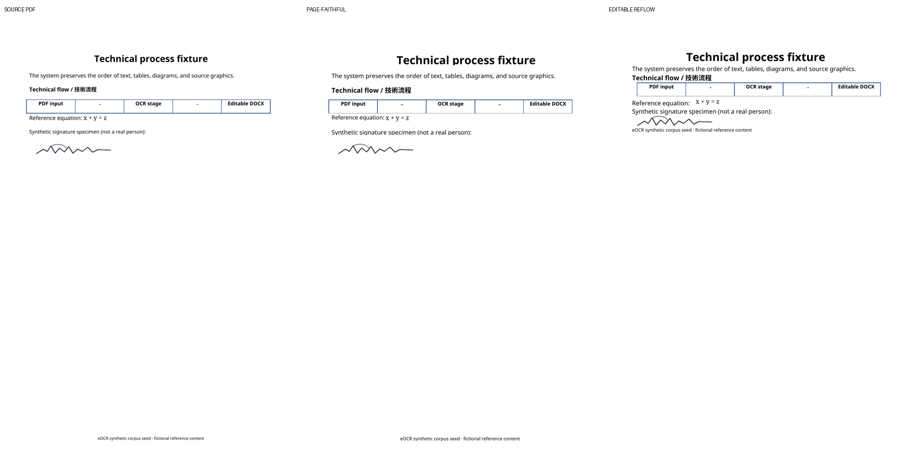

# Hybrid PDF → DOCX prototype

This disposable prototype isolates document construction from OCR. It includes the reviewed `fixture-en-signature.pdf` and its PAGE XML oracle text/geometry, crops source PDF renders for graphic assets, and builds four DOCX variants in the `eocr-corpus:local` container.

The source is a one-page, DOCX-exported A4 PDF with digital text, a vector flow diagram, a short formula, and one generated signature image. The signature is fictional and the fixture is CC0. The annotated baseline covers document construction; a separate signature-detection smoke run below passes detector-predicted geometry into the same builder. Neither path runs OCR, PDFium, `docx-rs`, or Rust.

## Run

From the repository root, build the existing pinned corpus container if needed, then run:

```sh
docker build -t eocr-corpus:local tools/corpus
docker run --rm -v "$PWD:/workspace" -w /workspace eocr-corpus:local \
  python prototype/build_prototype.py \
    --pdf prototype/fixtures/fixture-en-signature.pdf \
    --page-xml prototype/fixtures/page.xml \
    --eocr-json prototype/fixtures/eocr.json \
    --output prototype/results
```

The harness uses Poppler (`pdfinfo`, `pdftoppm`, `pdftocairo`), Pillow, `python-docx`, and LibreOffice Writer. It writes PDFs and PNG previews under `results/rendered/` and a machine-readable summary to `results/prototype-results.json`.

## Variants

| Output | Layout | Formula |
| --- | --- | --- |
| `page-faithful-omml.docx` | Page-relative DrawingML text boxes and anchored graphic crops | Editable OMML candidate |
| `editable-reflow-omml.docx` | Normal editable paragraph flow | Editable OMML candidate |
| `page-faithful-formula-fallback.docx` | Page-relative DrawingML | Source formula crop as PNG |
| `editable-reflow-formula-fallback.docx` | Normal editable paragraph flow | Source formula crop as PNG |

The technical figure is exported to a clipped SVG from the source PDF with a PNG picture fallback in the DOCX package. `pdfimages -list` reports only the signature image in the source PDF; the page-faithful fallback PDF contains only the formula and signature as raster images, so the diagram remains vector in that export. The signature crop is a PNG placed at the annotated page coordinates. The formula crop is retained alongside the DOCX variants.

## Results



LibreOffice rendered all four variants as one A4 page. The first attempt with legacy Word frames clipped text and images; replacing them with page-relative DrawingML text boxes and anchored images preserved this fixture's overall placement closely. Reflow preserves reading order and editability while moving the footer next to the preceding content. These are visual observations on one synthetic page, not quality scores for general PDFs.

### Microsoft Word check

The four DOCX variants were exported through Microsoft Word 16.0.14332 (build 16.0.14332). All four Word-generated PDFs are one page. Word displays the editable OMML equation in both page-faithful and reflow variants, and it displays the raster fallback in the other two variants. This resolves the Word-rendering uncertainty for the simple fixture formula; LibreOffice's failure to display OMML is a compatibility limitation of that renderer, not evidence that the equation is invalid in Word. The visual fallback still works in both renderers. See [Microsoft's MathML/OMML documentation](https://learn.microsoft.com/en-us/office/math/mathml).

| Variant | Word PDF | Rendered page |
| --- | --- | --- |
| Page-faithful, editable OMML | [PDF](results/word/page-faithful-omml.pdf) | [PNG](results/word/page-faithful-omml.png) |
| Editable reflow, editable OMML | [PDF](results/word/editable-reflow-omml.pdf) | [PNG](results/word/editable-reflow-omml.png) |
| Page-faithful, raster fallback | [PDF](results/word/page-faithful-formula-fallback.pdf) | [PNG](results/word/page-faithful-formula-fallback.png) |
| Editable reflow, raster fallback | [PDF](results/word/editable-reflow-formula-fallback.pdf) | [PNG](results/word/editable-reflow-formula-fallback.png) |

To reproduce the Word check, open each DOCX from `prototype/results/` in Microsoft Word and export it as PDF. The Word-generated PDFs and Poppler raster previews are checked in under `prototype/results/word/`.

The PAGE sidecar labels one signature region, which the prototype crops and places. This confirms crop-to-page geometry for an annotated region, but it does not evaluate signature detection or recall. The diagram and its five enclosed text regions are preserved visually as one SVG picture; its labels are therefore not independently editable.

### Signature-detection integration smoke run

Public model benchmarks and licensing notes are in [signature-detection research](../docs/research/signature-detection.md). After collecting those sources, YOLOS-tiny was run on the generated fixture with the pinned checkpoint and container image below. The weights are cached outside the repository at `%LOCALAPPDATA%\eocr-signature-detector-cache`; no model files are committed.

```powershell
$repo = (Get-Location).Path
docker run --rm --gpus all --memory 3g `
  -v "$env:LOCALAPPDATA\eocr-signature-detector-cache:/root/.cache/huggingface" `
  -v "${repo}:/workspace" -w /workspace `
  vllm/vllm-openai@sha256:6ee133356d49ed24cee03dd0cda3d3980279a11c107ce3e752c89e76540f41c9 `
  python prototype/detect_signature.py

docker run --rm -v "${repo}:/workspace" -w /workspace eocr-corpus:local `
  python prototype/build_detected_signature.py
```

The one-page fixture produced two overlapping boxes at score threshold 0.25. The top box scored 0.6484 (IoU 0.5681 against the fixture reference) and missed some signature ink; 10% padding on each axis made the crop contain the entire generated reference. The crop was substituted into a copy of PAGE XML, then embedded as a PNG in all four DOCX variants. Inspect `results/signature-detection.png` for the source (yellow reference, red detector boxes, lime padded crop) and `results/detected-signature/` for the generated PAGE XML, crops, DOCX files, and preview. The detector timing was model-forward-only: 4.405 ms p50 over 10 runs after 3 warmups, with 83.65 MiB peak CUDA allocation on RTX 5090. It is one synthetic integration smoke check, not a detector quality or end-to-end performance result.

The text, math, and diagram in this detector-driven run still come from oracle annotations. Keep the original annotated outputs as the baseline; the predicted-signature outputs are separate under `results/detected-signature/`.

The detected-crop `page-faithful-formula-fallback.docx` was also exported through Microsoft Word 16.0.14332 and rendered from its PDF. The signature is visible in the expected page region; the PDF and preview are `results/detected-signature/word-signature-check.pdf` and `results/detected-signature/word-signature-check.png`. This checks that the detector-derived crop survives a Word round trip, not that its localization is accurate on real documents.

## What this settles and what remains open

- Page-relative layout can preserve this page's broad geometry with DrawingML text boxes and anchored images.
- Normal flow is substantially easier to edit, but moves objects and the footer as paragraphs reflow.
- PDF vector content can be carried as an SVG picture with a raster fallback; it is not converted into native editable Word shapes.
- OCR quality remains unmeasured because text still comes from reference annotations. Signature detection has only the one synthetic smoke check described above, not a quality benchmark. The Word check validates rendering of the simple editable equation, not formula-recognition accuracy or complex equations.
- The actual product stack (PDFium + Rust DOCX writer), multi-page behavior, rotation/crop-box transforms, complex diagrams, tables, and real signature detection still need their own implementation/evaluation.

Issue #18 can now be reviewed with the detector-to-raster-crop path included; the fixture and the remaining limitations above should not be read as product-level quality evidence.
